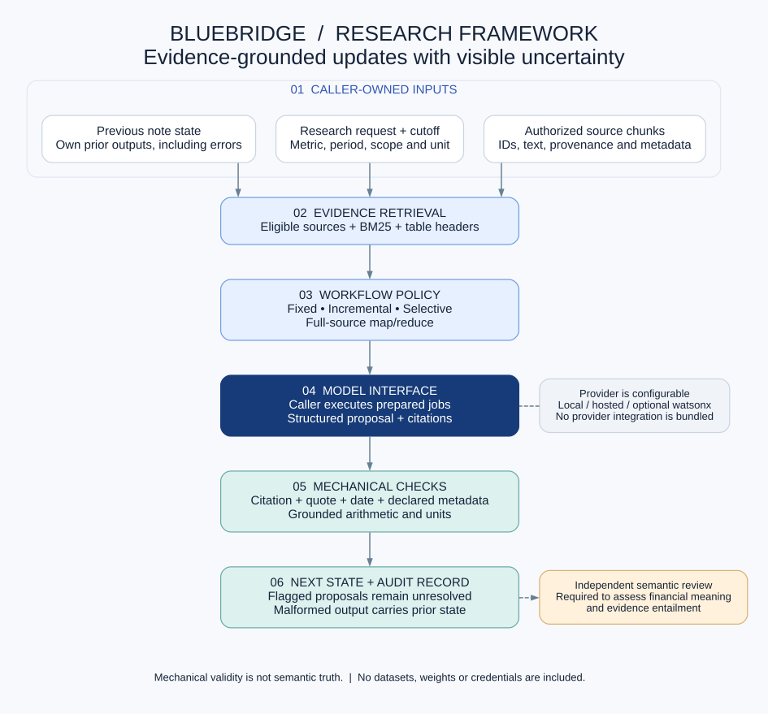
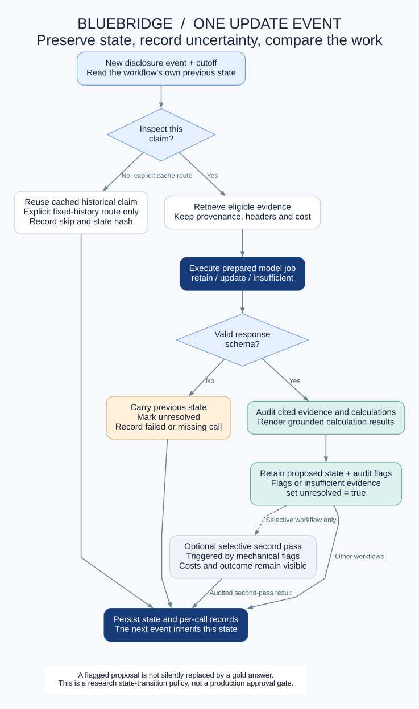
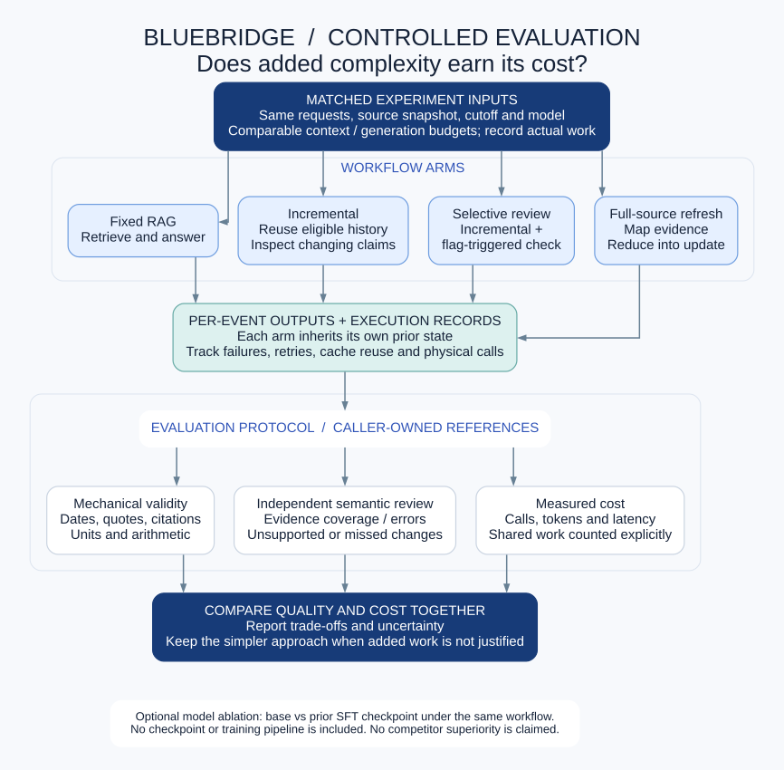

# BlueBridge Research Framework

**A model-independent framework for updating research notes as new evidence arrives.**

BlueBridge combines dated evidence retrieval, structured model proposals, deterministic checks, and persistent note state. It is a cleaned framework extraction from the project's V6 continuous-update research, rather than a release of every historical experiment.

> **Research display only; no general reuse license.** Some resources associated with the wider project belong to IBM or other rights holders. Their rights remain reserved. This repository excludes datasets, source-document collections, model weights, private project materials, credentials, and machine configurations. See [NOTICE](NOTICE.md) and [usage restrictions](LICENSE).

[中文说明](README.zh-CN.md) · [Architecture](docs/ARCHITECTURE.md) · [Research background](docs/RESEARCH.md) · [Evaluation protocol](docs/EVALUATION.md)



## Research question

When a new disclosure arrives, which existing claims need another investigation, what evidence is sufficient, and how should a note change? The framework makes those decisions and their costs observable. It supports comparisons against a strong fixed-retrieval baseline without assuming that more agents, checks, or training improve the result.

## Included components

| Component | Responsibility |
|---|---|
| `evidence_tools` | Source-cutoff filtering, explicit public-field projection, deterministic BM25 retrieval, citation/quote checks, bounded arithmetic with units. |
| `evidence_program` | Typed fact and calculation programs with explicit provenance and declared metric, period, scope, and basis. |
| `workflows` | Fixed retrieval, incremental routing, note-state transitions, selective and uniform second-pass preparation. |
| `active_acquisition` | Prepare a bounded evidence-search planning pass and turn its output into answer jobs. |
| `full_refresh` | Full-source map/reduce preparation, provenance receipts, and explicit raw-source fallback. |

All five modules use the Python standard library. They prepare provider-neutral message jobs; the caller supplies model execution. IBM watsonx can be connected through that boundary, but no IBM integration or entitlement is bundled or implied.

## Local verification

The commands below are for project verification by authorized maintainers. Public visibility does not change the usage restrictions.

```bash
python3 -m venv .venv
source .venv/bin/activate
python -m pip install -e .
python -B -m unittest discover -s tests -v
python examples/offline_update.py
```

The demonstration creates a tiny fictional company example in memory and uses a clearly labeled scripted response. It makes **no model call**, performs **no training**, and downloads **no data**. It demonstrates interface and state behavior, not model accuracy.

Runtime dependencies: Python 3.10+ and its standard library. No model SDK is required. Graphviz is optional for regenerating the diagrams.

## Model boundary

```python
from bluebridge.workflows import initial_state, prepare_event, reduce_event

state = initial_state(episode)  # caller-provided, authorized evidence and claims
prepared = prepare_event(episode, state, event_index=0, arm="fixed_zero")

# Provider-specific code belongs to the caller. Preserve the exact job IDs.
outputs = [
    {"job_id": job["job_id"], "text": your_model_call(job["messages"])}
    for job in prepared["jobs"]
]
result = reduce_event(episode, state, 0, prepared, outputs)
state = result["state"]
```

`your_model_call` is an integration placeholder, not a supplied function. See the [offline example](examples/offline_update.py) for a complete runnable path. Provider choice, authentication, tokenization, inference budgets, and billing remain caller responsibilities.

## State and checks



The framework preserves the original research behavior:

- Each experimental arm carries its own previous output into later events.
- Mechanically flagged proposals are retained **with `unresolved=True` and their audit flags**.
- Invalid, missing, or failed model responses carry the previous note forward as unresolved.
- Incremental routing may skip an explicitly fixed historical claim when cached evidence remains available and no lexical correction signal is found.
- A selective pass is triggered by mechanical flags, not by access to a hidden reference answer.

**Passing a mechanical check does not establish semantic truth.** The checks do not prove that a selected table column, accounting interpretation, or narrative conclusion is correct. This is an experimental state machine, not a production approval gate or autonomous investment adviser.

## Controlled comparisons



Compare methods on the same sources, cutoff, initial note, model, and declared budget. Report evidence coverage, unsupported claims, unresolved outputs, calls, tokens, and elapsed model-call time separately. A complete-pass measure should accompany partial credit. Semantic review must be independent of model inputs.

Historical experiments found that a strong simple RAG baseline could outperform more elaborate workflows. This repository therefore presents an inspectable framework and a research protocol, **not a claim of superiority over commercial products**. See [research findings and limitations](docs/RESEARCH.md).

## Public release boundary

Included: five reusable V6 modules, synthetic unit tests, one in-memory fictional demonstration, architecture diagrams, and summarized research context.

Excluded: all research datasets and labels; source documents and excerpts; real-company model responses; interviews and sponsor feedback; adapter/base-model weights; SSH/cloud credentials; machine-specific launchers; historical training scripts and run archives. Earlier SFT/RL work is described as background only.

Optional examples must be supplied explicitly by a caller; the public framework never loads the original frozen few-shot dataset. Arm labels such as `sft_tools` identify an experimental configuration but do not load or train an adapter.

## Repository map

```text
src/bluebridge/       Five model-independent V6 components
tests/               Synthetic CPU-only checks
examples/            Offline, fictional interface demonstration
docs/                Architecture, evaluation, research and release notes
docs/figures/        Editable DOT plus SVG/PNG diagrams
scripts/             Diagram rendering and public-release validation
```

This is a student research framework associated with a capstone project. It is not an official IBM product and does not imply IBM endorsement. IBM names and third-party trademarks belong to their respective owners.
