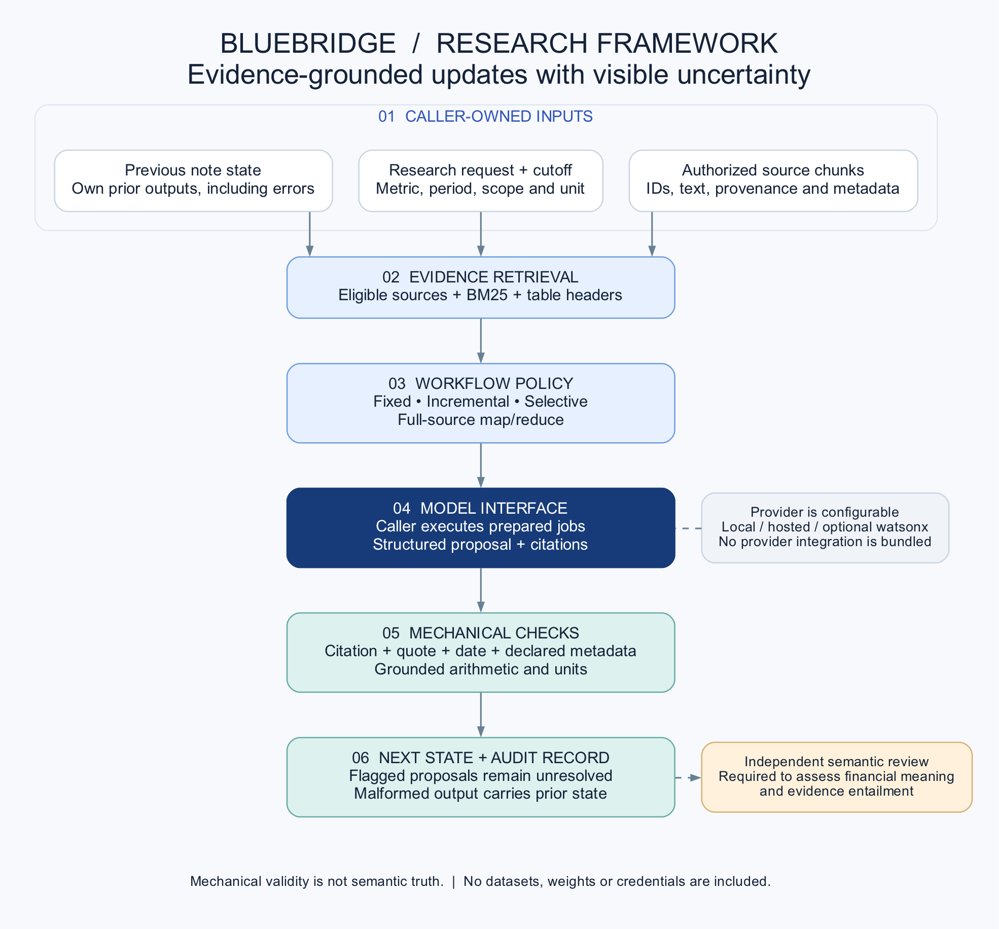

# BlueBridge 研究框架

这个仓库把 V6 阶段较完整的模块整理成一个可检查、可测试的框架，研究**新材料到来后，如何查找证据、更新已有研究结论，并比较不同流程的质量与成本**。

它是公开展示版，**不是开放授权的开源项目**。未经相应权利人授权，不得用于其他用途。项目相关的部分资源属于 IBM 或其他权利人；这些资源的权利不因本仓库公开而转移。具体见 [使用限制](LICENSE) 和 [权利说明](NOTICE.md)。



## 这次发布了什么

- 证据检索：按可用日期筛选，使用 BM25 检索并保留表格上下文。
- 确定性工具：检查引文、原文片段、数值操作数、单位和声明的元数据。
- 连续更新：保留上一轮笔记，比较固定检索、增量更新、选择性复核等流程。
- 主动取证：准备受预算约束的检索计划，再准备回答任务。
- 全文更新：将全文分段处理，检查来源对应关系，并保留失败回退记录。
- 合成单元测试、一个纯离线的虚构演示，以及架构图、更新流程图、实验对照图。

所有核心模块只依赖 Python 标准库。框架生成消息任务，具体模型由调用方接入；本地模型、托管模型或 IBM 平台都可以通过相同的接口对接，但本仓库没有宣称完成所有这些平台的集成。

## 没有上传什么

没有上传任何实际研究数据集、标签、原始披露文档、真实公司模型回答、访谈、客户反馈、模型权重、凭据或 SSH 机器配置。早期六个阶段没有整包上传，只在 [研究背景](docs/RESEARCH.md) 中简述 SFT、RL 与后续对照结论。

测试和演示中的内容是代码内直接构造的虚构样例，用于验证程序行为，不是研究训练集或评测集。

## 如何理解演示

授权的项目维护者可以按英文 README 的步骤安装并运行测试，然后执行：

```bash
python examples/offline_update.py
```

演示不下载数据、不调用模型、不训练。它展示“准备证据 → 接收结构化回答 → 检查 → 更新状态”的过程；脚本回答已经明确标为 mock，不代表任何模型的实际能力。

## 需要准确理解的边界

1. **检查通过不等于语义正确。** 程序能检查引用是否存在、单位是否一致，不能保证模型理解了正确的表格列或业务含义。
2. **当前状态机制保留实验中的错误。** 有机械检查问题的回答会进入状态，但带 `unresolved=True` 和审计标记；格式错误或调用失败时，保留上一轮状态并标为待解决。它不是生产环境的审批系统。
3. **V6 没有新增训练。** 历史 8B SFT 学习的是最终回答和结论修改，不是完整的长程搜索策略；本仓库也不包含这些权重。
4. **没有预设复杂方案更好。** 既有实验中，简单 RAG 很强，更多思考、复核和旧 SFT 迁移没有稳定全面胜出。
5. **没有直接证明优于竞品或节省分析师时间。** 调用量、模型耗时、答案覆盖率和人工实际节时需要分开评估。

此仓库用于展示研究结构与可检查的实现，不是 IBM 官方产品，也不代表 IBM 背书。
