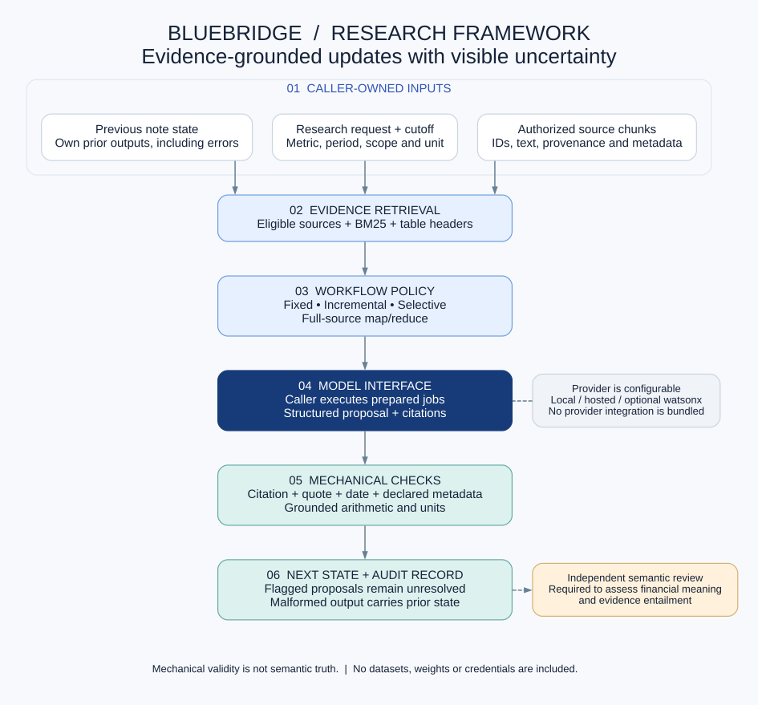
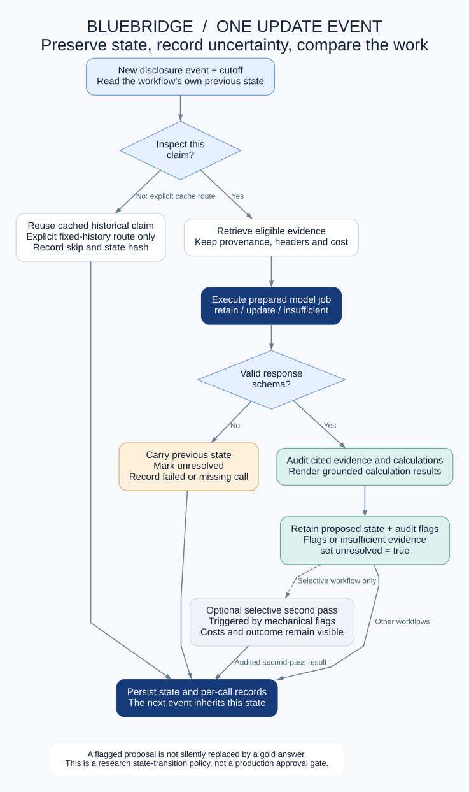

# Architecture and integration contract

## Caller-owned inputs

An episode is a dictionary with `episode_id`, `issuer`, `initial_as_of`, `sources`, `chunks`, `initial_claims`, and `events`.

| Object | Main fields |
|---|---|
| Source | `source_id`, `published_at`, optional descriptive metadata and URL. |
| Chunk | `chunk_id`, `source_id`, `text`, optional locator and metadata. |
| Initial claim | `claim_id`, `instruction`, `text`, `citations`, `metric_spec`. |
| Event | `event_id`, `as_of`, `new_source_ids`. |
| Metric specification | Explicit metric, period, unit, scope, basis, and temporal policy where applicable. |

The caller is responsible for authorized acquisition, correct source metadata, chunking, and persistence. Source publication eligibility and discovery are separate. Unknown or duplicate identifiers fail the mechanical eligibility filter.

No dataset or source document is loaded by the public package. Optional few-shot examples must be passed explicitly by the caller. The fictional offline demonstration shows the dictionary shape without including research data.

## Core sequence

1. `workflows.initial_state(episode)` creates the starting note state.
2. `workflows.prepare_event(episode, state, event_index, arm, examples=None)` prepares model jobs and evidence/cost sidecars.
3. The caller executes each job with a chosen model. Jobs contain `job_id`, `messages`, and `max_new_tokens`.
4. The caller returns objects containing the same `job_id` and model-generated `text`, or an `error` for a failed call.
5. `workflows.reduce_event(...)` parses proposals, performs mechanical checks, renders grounded calculations, and returns state and records.
6. Optionally prepare a selective or uniform check pass, accounting for the additional work.

A finish proposal declares `tool="finish"`, `disposition` (`retain`, `update`, or `insufficient`), `value`, `unit`, `citations`, `reason`, `patch`, `evidence_quotes`, and `calculations` where used.

## State semantics

A valid-schema proposal updates the experimental note state. Mechanical flags mark that state unresolved but do not replace it with a hidden correct answer. Invalid-schema or failed responses carry forward the previous state as unresolved. Prepared work includes a previous-state hash; reducing against a different prior state is rejected.

The distinction is intentional: preserving the model's mistakes makes error accumulation measurable. A production candidate-versus-approved-state workflow would be an additional design with its own tests; it is not silently claimed here.

## Evidence programs and arithmetic

`evidence_program.execute` takes a typed program, episode, claim, and cutoff. It verifies literal evidence binding and declared metadata before rendering results. `evidence_tools.calculate` uses a bounded expression parser and explicit units; it does not execute arbitrary Python expressions.

These checks do not establish financial entailment. Choosing the appropriate fact, column, metric, accounting basis, and narrative interpretation remains a model/reviewer responsibility.

## Provider integration

The framework has no mandatory model backend. A provider adapter maps prepared messages and generation limits to the provider API, then returns the generated text without changing its job identifier. Keep credentials in external secret storage, never in episodes, examples, source files, or committed configuration.

For IBM watsonx, implement this boundary using services actually provisioned in the caller's account. For a local model, use a separate inference process and report its exact base/adapter identifiers. No provider integration, model weights, or training launcher is included in this public extraction.
