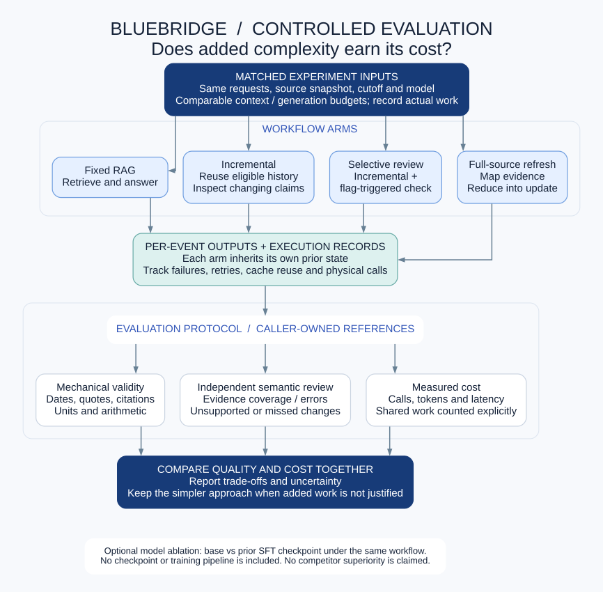

# Evaluation design

This is a protocol for future authorized experiments, not an included benchmark or a claim that new experiments have been run for the public release.

## Matched configurations

Start with `fixed_zero` (no-example fixed retrieval). Add `incremental_tools`, `incremental_selective`, and full-source map/reduce as specific hypotheses. Keep the source universe, cutoff, task wording, initial note, model revision, generation settings, and overall budgets comparable.

Use an explicit examples argument if testing few-shot prompting. Record its hash and keep examples separate from held-out tasks. A label such as `sft_tools` does not load a model: the external runner must identify the base model and adapter actually used.

If two arms share an identical physical call, retain both logical accounting and physical execution accounting. Do not hide failed calls, retries, mapping failures, or fallback work.

## Independent measures

| Measure | Interpretation |
|---|---|
| Mechanical validity | Parseability, existing citations, exact-quote presence, declared source cutoff, grounded arithmetic and unit consistency. |
| Semantic evidence coverage | Whether each requested factual or qualified claim is supported by the cited evidence. Requires independent review. |
| Unsupported statements | Wrong period, column, scope, unit, accounting basis, unsupported causality, or fabricated findings. |
| Complete support | All required elements supported; report alongside partial credit rather than replacing it. |
| Continuation quality | Missed changes, erroneous carryover, unresolved claims, and correctness across successive events. |
| Cost | Logical/physical calls, actual input/output tokens, model-call time, failures/retries, and declared deployment prices. |
| Human effort | Time to an acceptable checked note, corrections, and review burden in a separate human study. |

Preserve each arm's own previous answer. Do not reset it to a reference note between events. Score both successful repairs and accumulated mistakes.

## Semantic review

Program checks are necessary diagnostics, not semantic judges. An LLM reviewer may assist with evidence-grounded scoring, but should receive the question, output, authorized sources, and a predeclared rubric while being blinded to the method. Calibrate it against human review and report disagreements. Do not tune labels after seeing a favored method's results.

Keep reference requirements and reviewer decisions outside actor prompts. An incomplete answer may earn justified partial credit while still failing complete support. Dataset sizes, company clusters, correlated claims, and uncertainty must remain visible.

## Testing a training intervention

Compare a common SFT starting point, continued SFT with matched data/compute, and the proposed RL intervention. Verify actual adapter changes. For action-policy training, include observed search/open/check/finish sequences with validated consequences; final-answer examples alone do not establish an action policy.

Only optimize a reward after confirming that it distinguishes evidence-supported outputs from plausible but unsupported outputs. Keep training, validation, and frozen new-task evaluation separate. Model size, reward design, retrieval quality, and training volume should not all change in a single comparison.
